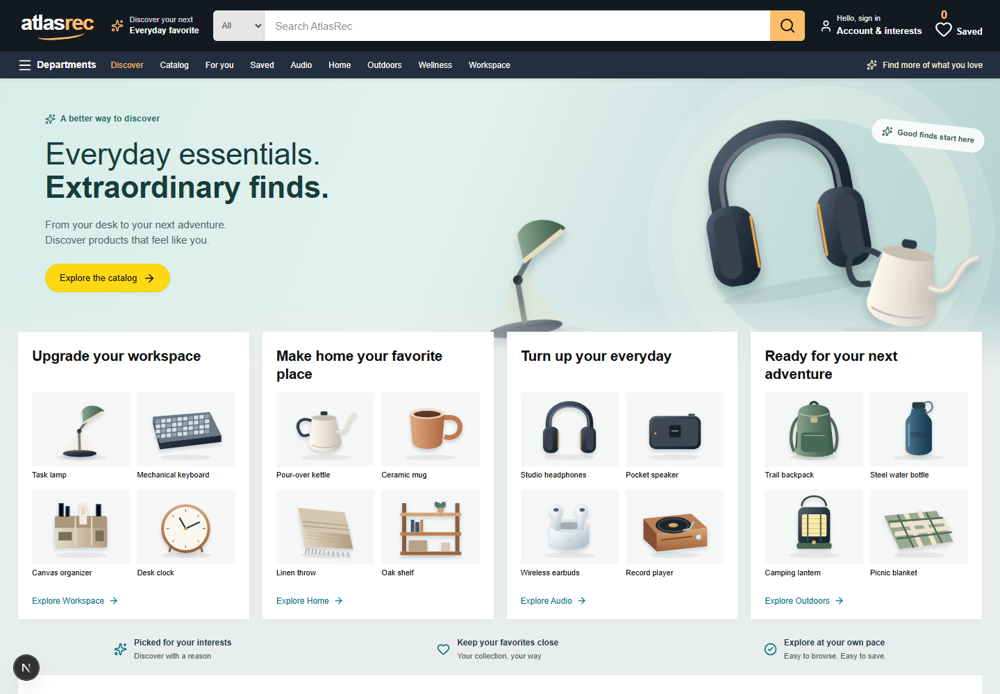
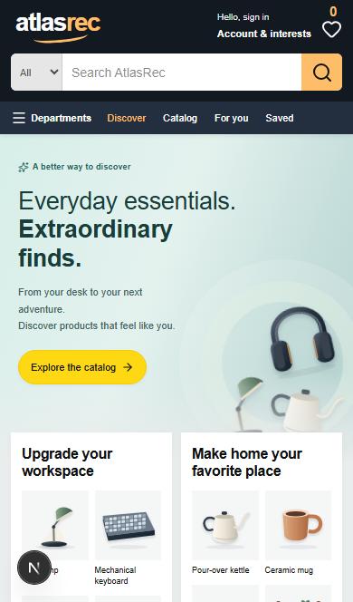
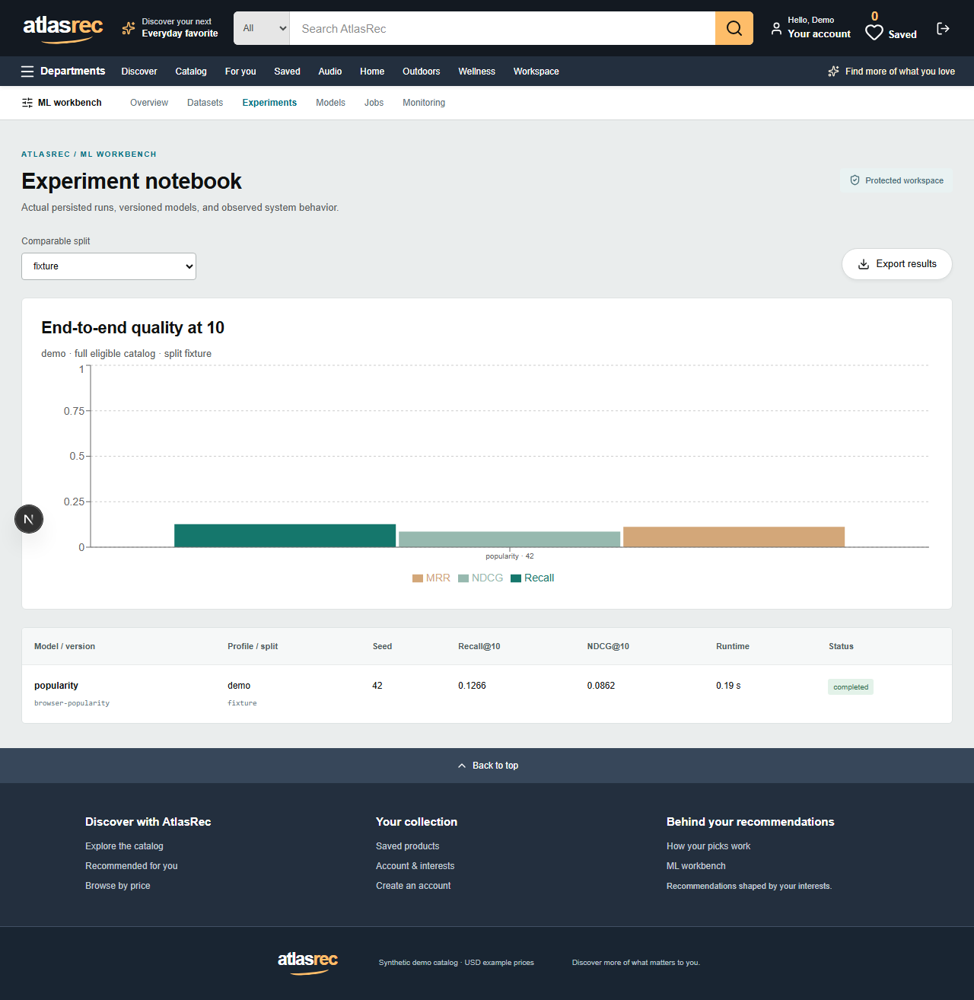

# AtlasRec
A local product discovery application and an ML engineering workbench, built with
Next.js JavaScript, FastAPI, PostgreSQL, Redis/Celery and a shared Python ML package.

The real retail upgrade adds **6,692 source products, 52,249 historical reviews and
9,947 pseudonymous reviewers**, with source photography for 5,886 products. Three
models have been trained and evaluated on this data. See [REAL_DATA.md](docs/REAL_DATA.md)
for provenance, reproduction, activation and the distinction between historical
reviewers and actual AtlasRec accounts. Restart an installed catalog with:

```powershell
python scripts/manage.py start
```

Current status: **real retail verification in progress; the HTTP performance target remains open**.
Six actual demo models and an 18-run research benchmark executed. Docker startup,
PostgreSQL integration, real worker recovery, promotion/rollback, production build,
and desktop/phone browser journeys passed. The HTTP latency goal was missed.
The earlier bug audit passed 29 Python cases and six desktop/phone browser checks.
The storefront refresh passed seven targeted API cases and 18 desktop/phone browser checks.
The storefront now has an Amazon-inspired shopping header, department panels,
product shelves, catalog filters, image zoom and persisted personal ratings.
See [UI_REDESIGN.md](docs/UI_REDESIGN.md), [STATUS.md](STATUS.md),
[BUILD_REPORT.md](docs/BUILD_REPORT.md) and [BUG_AUDIT.md](docs/BUG_AUDIT.md).

## Initialize the optional synthetic demo
Prerequisites: Docker Desktop with working WSL2 on Windows, and Python to run the
standard-library launcher. The launcher itself works with the system Python; the
ML runtime is installed inside the images. Native development needs Python 3.12/3.13,
uv, and Node 24 with npm.

From the project directory:

```powershell
python scripts/manage.py doctor
python scripts/manage.py demo
```

On Unix, use python3 if python is unavailable. demo creates .env from .env.example if
missing, builds the stack, migrates PostgreSQL, seeds missing demo records, trains a
small real popularity model, and reuses compatible active models on subsequent runs.
It preserves favorites, accounts, preferences and model artifacts. The first dependency
download/build can take a long time on an 8GB machine; avoid concurrent native/Docker builds.

Shop: [http://localhost:3000](http://localhost:3000)
Workbench: [http://localhost:3000/admin](http://localhost:3000/admin)
OpenAPI: http://localhost:3000/api/v1/openapi.json

Local demo access: admin@atlasrec.local / AtlasDemo!2026, documented in docs/DEMO.md.
These credentials are for the explicit local demo profile. Use a separate database,
HTTPS, private networking and fresh credentials for any deployment.

```powershell
python scripts/manage.py stop
```

stop preserves volumes. reset is an explicit destructive demo-only command and must
be confirmed with --yes-reset-demo. It is unnecessary for ordinary startup.

## Native checks and experiments
```powershell
uv sync --python 3.12 --frozen
npm ci
python scripts/manage.py verify
python scripts/manage.py benchmark --config configs/benchmark.yaml
python scripts/fetch_research.py
python scripts/manage.py research --config configs/research.yaml
```

If PATH's npm shim is broken, the launcher locates the npm CLI shipped with Node.
Windows worktrees with long paths use extended Python paths; FAISS bundles use Python
byte IO to support Unicode paths. See docs/WINDOWS.md.

The benchmark command trains comparable models and measures in-process inference.
scripts/benchmark_bundles.py measures existing bundles. Full HTTP/DB/cache measurements
are separate and must state the workload. scripts/container_check.py verifies actual
persisted shopper state, concurrent event IDs, a real worker job, promotion and rollback.

## Evidence and interpretation
Demo: 200 products, 100 users, 3,000 generated events; item-CF NDCG@10 0.2097 versus
popularity 0.0862. These demonstrate software behavior and are not real-world quality.

Research: official Amazon Reviews 2023 Digital Music files, 39,886,470 bytes total.
A deterministic 5% user sample retained 6,402 events. All six models over three seeds
scored zero test NDCG@10 on only 26 eligible users, with no warm test users. The sparse
sample does not support a useful superiority claim. No synthetic results were substituted.
Data and model files stay out of source sync/Git; do not redistribute source data.

Exports: docs/evidence/demo-benchmark.json, research-benchmark.json,
model-serving-benchmark.json and http-benchmark.json. Synthetic/profile labels, source
hashes, configs, split IDs, uncertainty, candidate misses and artifact checksums are retained.

## Guide to the code
- apps/web: responsive discovery UI and protected workbench; transport proxy only.
- services/api/atlasrec_api: identity, ownership, persisted events, recommendations, jobs and registry.
- packages/ml/atlasrec_ml: ingestion, training-only features, six models, metrics and immutable bundles.
- scripts/manage.py: cross-platform doctor/demo/verify/research/benchmark/stop.
- docs/ARCHITECTURE.md, ML_DESIGN.md and LEARNING_GUIDE.md: explanations and exercises.
- docs/BUILD_REPORT.md: acceptance evidence and limitations.

The requested Desktop folder is a source copy of the Codex worktree. Run from either
directory; the atlasrec Docker project uses the same named persistent volumes. Do not
run two copies on port 3000 simultaneously. scripts/sync-desktop.ps1 copies project source
and evidence without replacing unrelated files.

This is a portfolio application. It has no payment/shipping features, production traffic,
proven sales lift, external deployment, or automatic promotion based on drift.


## Actual UI captures





Desktop and phone captures come from the actual PostgreSQL/Redis/Celery application.
The final browser JSON and queue recovery report are under docs/evidence. The warm IPv4
HTTP benchmark recorded 200 requests and zero errors but missed the latency target
(p95 4384.05ms). Its initial localhost failure is retained separately; see [EVALUATION.md](docs/EVALUATION.md).
