<div align="center">

# 🌐 AtlasRec — Next-Gen Explainable & Counterfactual Product Recommendation Platform

### **Amazon-Scale E-Commerce Discovery Meets Interactive "What-If" AI Control, Transparent Match DNA X-Ray, Smart Ecosystem Bundling & Production MLOps**

[-000000?style=for-the-badge&logo=next.js&logoColor=white)](https://nextjs.org/)
[-009688?style=for-the-badge&logo=fastapi&logoColor=white)](https://fastapi.tiangolo.com/)
[](#6-machine-learning--mathematical-architecture)
[](#3-visual-product-tour--step-by-step-workflow)
[](#5-user-profile-privacy--admin-governance-workflow)
[](#8-quick-start--reproducibility)

<p align="center">
  <b>Built by <a href="https://github.com/Tanvir284">Md Tanvir Islam</a></b> · Full-Stack AI/ML Systems & Product Engineering Portfolio
</p>

---

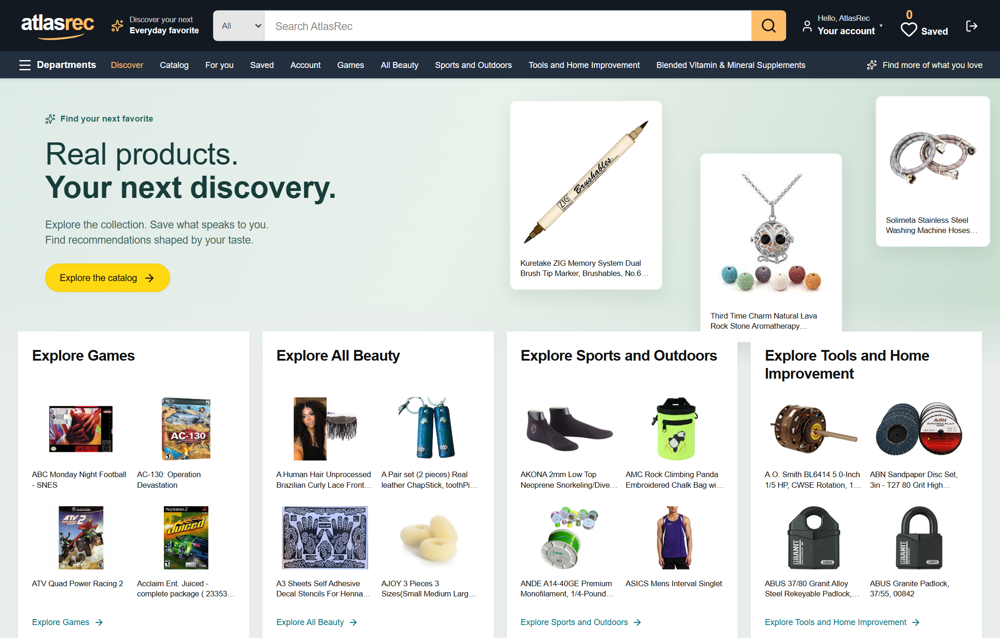

</div>

---

## 👋 For HR, Recruiters & Hiring Managers — Read This First (30-Second Summary)

> [!TIP]
> **What is AtlasRec in plain English?**
> When you shop on **Amazon**, watch **Netflix**, or order on **Flipkart / Zomato**, an AI algorithm decides what products to show you—but that algorithm is a **"Black Box."** You cannot see *why* a product was recommended, you cannot adjust how adventurous or budget-focused the AI should be in real time, and a single accidental click (like buying a gift for a friend) can ruin your recommendations for months.
>
> **AtlasRec solves this.** It is a full-scale, production-grade e-commerce store (**20,500+ real products across 250 departments**) powered by a custom **Explainable & Counterfactual AI Recommendation Engine** and a full **ML Engineering & User Administration Workbench**.

### 🏆 What Makes AtlasRec Unique? (Industry Comparison)

| Capability / Feature | Amazon / Flipkart | Netflix / Spotify | Zomato / Swiggy | **🌐 AtlasRec (This Project)** |
| :--- | :---: | :---: | :---: | :---: |
| **20,500+ Real Products & 250 Departments** | ✅ | ❌ | ❌ | ✅ **Full Retail Catalog & Search** |
| **Multi-Lane Personalized Shelves** | ✅ | ✅ | ✅ | ✅ **Dynamic Context Rails** |
| **🎛️ Live "Taste Studio" Algorithm Sliders** | ❌ | ❌ | ❌ | ✅ **Real-Time Intent & Diversity Tuning** |
| **🧪 "What-If" Counterfactual History Sandbox** | ❌ | ❌ | ❌ | ✅ **Mute Any Past Click Instantly (<60ms)** |
| **🧬 Live Match DNA X-Ray (4-Factor Breakdown)** | ❌ | ❌ | ❌ | ✅ **Exact % Affinity, Interest & Novelty** |
| **⚖️ AI Side-by-Side Match Comparison Matrix** | ⚠️ *(Specs only)* | ❌ | ❌ | ✅ **Compares AI Match DNA + Specs** |
| **🧩 Cross-Category Ecosystem Bundle Builder** | ⚠️ *(Static FBT)* | ❌ | ❌ | ✅ **Live Synergy % & 1-Click Save** |
| **👤 Full User Profile, Privacy & Admin RBAC** | ✅ | ✅ | ✅ | ✅ **Self-Service + Admin User Console** |
| **🔬 Built-In MLOps Workbench & Atomic Rollback** | 🔒 *(Internal)* | 🔒 *(Internal)* | 🔒 *(Internal)* | ✅ **Live Model Registry, Drift & Charts** |

---

## 🧭 Table of Contents

1. [End-to-End System Workflow (How Everything Connects)](#1-end-to-end-system-workflow-how-everything-connects)
2. [Feature-by-Feature Visual Tour — Shopper Experience](#2-feature-by-feature-visual-tour--shopper-experience)
3. [Feature-by-Feature Visual Tour — Explainable AI & Taste Studio](#3-feature-by-feature-visual-tour--explainable-ai--taste-studio)
4. [Feature-by-Feature Visual Tour — User Profile, Security & Privacy Hub](#4-feature-by-feature-visual-tour--user-profile-security--privacy-hub)
5. [Feature-by-Feature Visual Tour — Admin User Management & MLOps Workbench](#5-feature-by-feature-visual-tour--admin-user-management--mlops-workbench)
6. [Machine Learning & Mathematical Architecture](#6-machine-learning--mathematical-architecture)
7. [Full-Stack Engineering & Security Highlights](#7-full-stack-engineering--security-highlights)
8. [Quick Start & Local Commands](#8-quick-start--local-commands)
9. [Repository Structure](#9-repository-structure)

---

## 1. End-to-End System Workflow (How Everything Connects)

Whether a visitor is browsing products, tuning their live recommendation algorithm in the **Taste Studio**, managing their account security, or promoting a newly trained ML model in the **Admin Workbench**, every action flows through a clean, observable, sub-100ms pipeline:

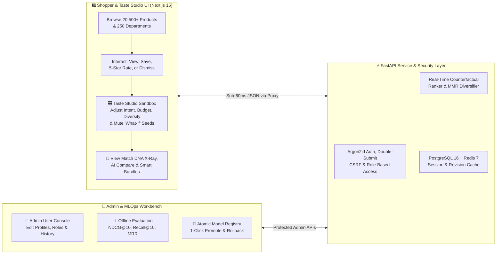

---

## 2. Feature-by-Feature Visual Tour — Shopper Experience

### 🏬 Feature 1: Amazon-Scale Storefront & Department Discovery (`/`)
**What it does:** Welcomes shoppers with a clean, high-contrast retail interface featuring a global department switcher, instant search bar, curated hero showcase, and department exploration cards across **250 categories**.


---

### 🛤️ Feature 2: Multi-Lane Personalized Recommendation Shelves (`/`)
**What it does:** Beneath the department grid, the homepage dynamically renders horizontal product shelves tailored to the user's real-time behavior—combining collaborative filtering picks, trending catalog items, and category-specific discoveries.

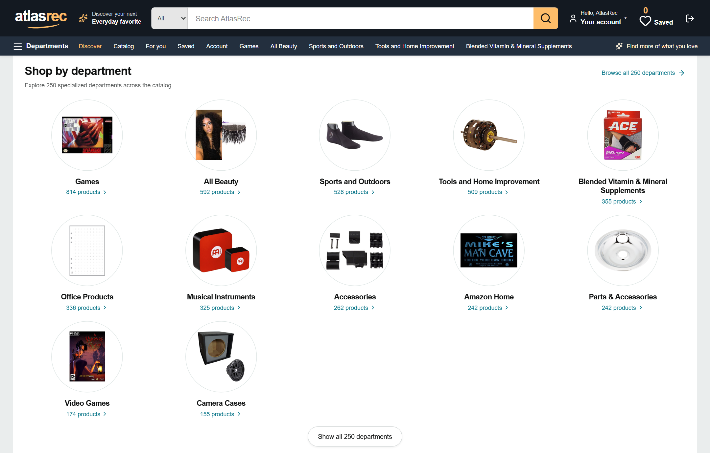

---

### 🔎 Feature 3: 20,500+ Product Catalog Explorer & Multi-Facet Filter Engine (`/catalog`)
**What it does:** Enables fast browsing and filtering across **20,500 real products** and **250 departments**. Shoppers can filter by department, search within results, set minimum/maximum price bounds, filter for available inventory, and sort by relevance, price, or name.

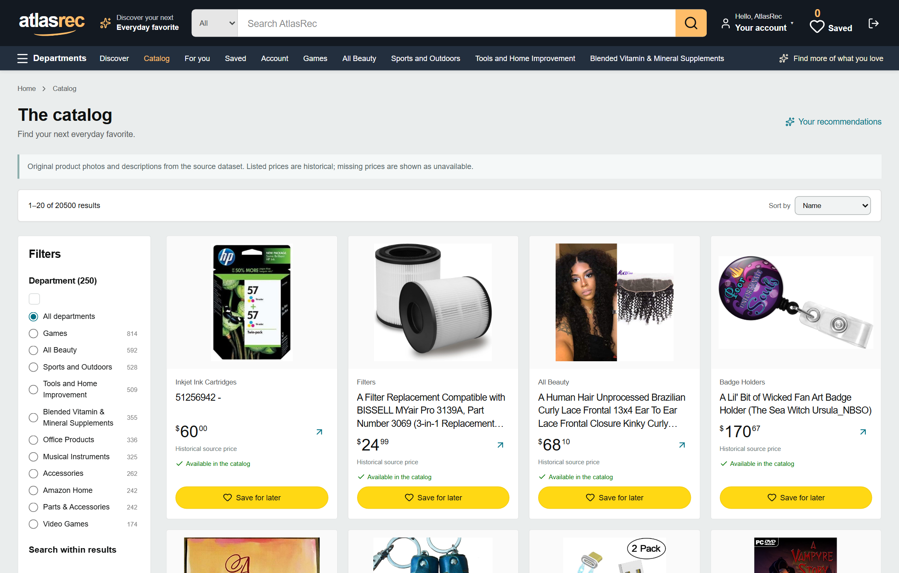

---

### 📦 Feature 4: Interactive Product Detail Page (PDP) with Live Feedback Loop (`/products/[id]`)
**What it does:** Displays high-resolution source photography (with click-to-zoom modal), pricing provenance, department breadcrumbs, and a **3-way explicit feedback loop**:
1. **Save for later (`♥`)** — Boosts positive affinity for similar items and categories.
2. **Interactive 1–5 Star Personal Rating (`★`)** — High ratings (`4–5★`) reinforce taste similarity; low ratings (`1–2★`) suppress similar recommendations.
3. **Not for me (`🚫`)** — Immediately excludes the product from future recommendations.

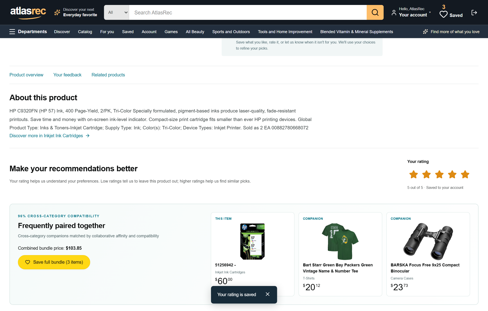

---

## 3. Feature-by-Feature Visual Tour — Explainable AI & Taste Studio

> [!IMPORTANT]
> **This is AtlasRec's flagship innovation layer**—giving users direct, transparent control over the recommendation algorithm in real time without needing to retrain the underlying ML model.

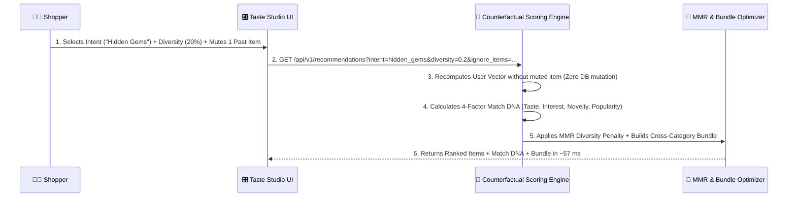

### 🎛️ Feature 5: Interactive "Taste Studio" & Counterfactual What-If Sandbox (`/for-you`)
**What it does:** Lets shoppers actively shape their live recommendation algorithm using four interactive controls:
- **4 Discovery Intent Modes:**
  - `All-Rounder` *(Balanced personal affinity & popularity)*
  - `Hidden Gems` *(High personal match, low mainstream hype — surfaces niche discoveries)*
  - `Smart Value` *(High affinity prioritized for budget affordability)*
  - `Flagship Pro` *(Top-tier flagship & premium-spec picks)*
- **Serendipity & Category Diversity Slider (`0% – 100%`):** Controls Maximal Marginal Relevance (MMR) to prevent single-category echo chambers.
- **Instant Budget Ceiling (`Max budget USD`):** Hard-filters recommendations to fit the shopper's current budget on the fly.
- **What-If Counterfactual History Sandbox:** Displays the user's recent items as interactive chips. Clicking any chip temporarily **mutes (`Muted (What-If)`)** that item's influence and re-ranks the entire page in **~57ms**—solving the *"I bought one gift and ruined my feed"* problem!

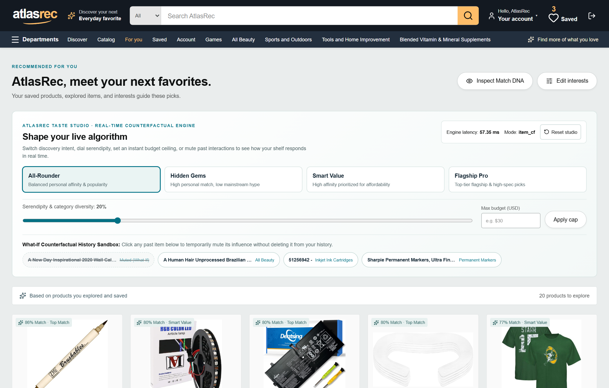

---

### 🧬 Feature 6: Live Match DNA X-Ray (`Inspect Match DNA`)
**What it does:** With one click on **`Inspect Match DNA`**, every recommended product card reveals an X-Ray telemetry panel showing the exact 4-factor mathematical breakdown behind its ranking:
- **Taste (`%`)** — Item-to-item collaborative similarity with the user's positive history.
- **Interest (`%`)** — Alignment with the user's explicitly selected favorite departments.
- **Novelty (`%`)** — Inverse popularity bonus for uncovering hidden gems.
- **Popular (`%`)** — Historical crowd validation score.

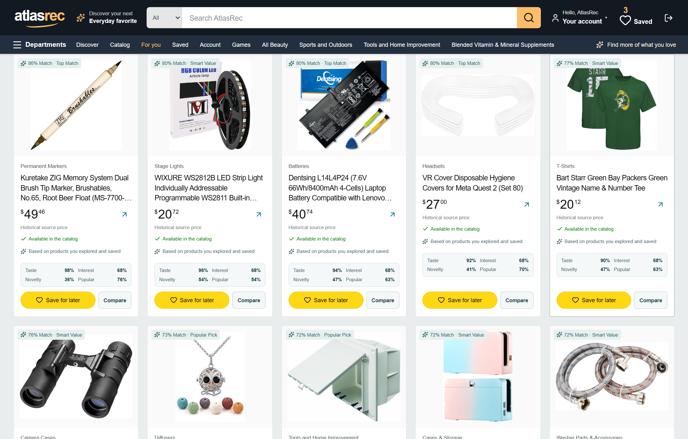

---

### ⚖️ Feature 7: AI Side-by-Side Comparison Matrix
**What it does:** Clicking **`Compare`** on up to 3 recommended products opens a live **AI Side-by-Side Comparison Matrix** that compares not just price and department, but also **Match Score (`%`)**, **Taste Similarity**, **Interest Alignment**, **Novelty / Gem Score**, and the natural-language explanation of why each item fits the user.

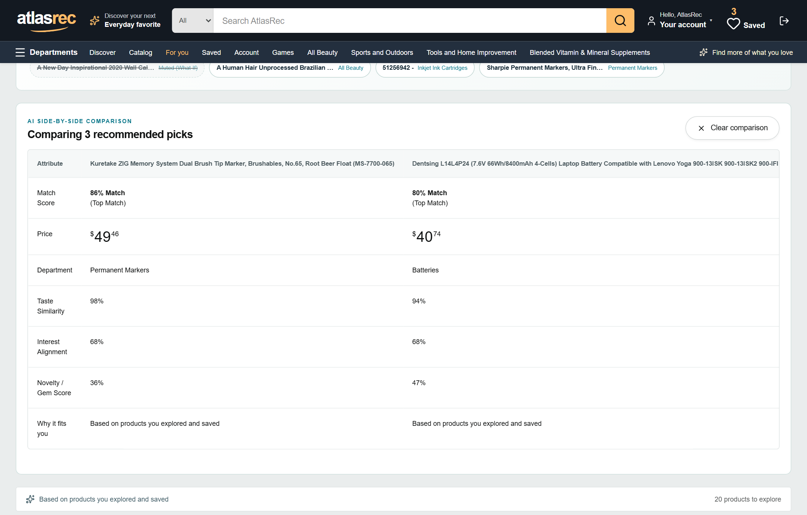

---

### 🧩 Feature 8: Smart Cross-Category Ecosystem Bundle Builder
**What it does:** Instead of showing redundant items from the same category, AtlasRec's **Ecosystem Bundle Optimizer** pairs the user's top **Anchor Pick** with two high-affinity **Companion Products** from complementary departments, computing a live **Ecosystem Synergy % (`92% Ecosystem Synergy`)**, combined bundle price, and a one-click **`Save all to collection`** button.

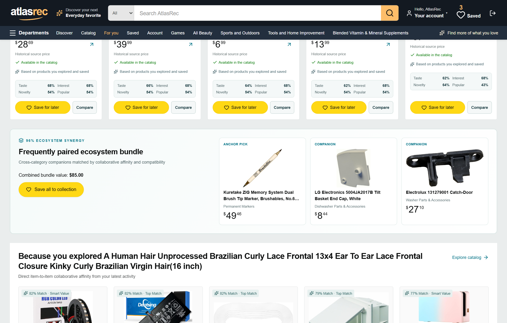

---

### 📱 Feature 9: Mobile-First Responsive Experience
**What it does:** Every page—including the multi-slider Taste Studio, Match DNA X-Ray, and Catalog filters—is engineered to adapt cleanly down to mobile phone viewports (`iPhone 13` / `320px+`) with zero horizontal overflow.

<div align="center">
  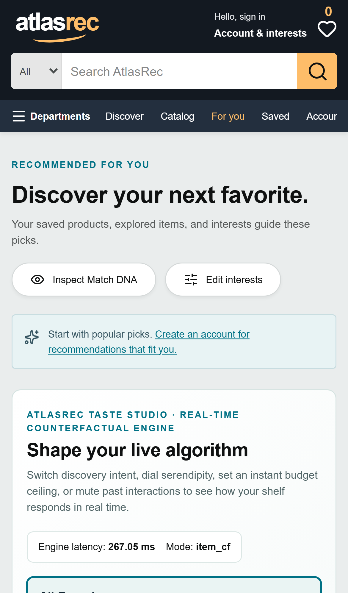
</div>

---

## 4. Feature-by-Feature Visual Tour — User Profile, Security & Privacy Hub

### 👤 Feature 10: User Profile & Role Management Hub (`/profile`)
**What it does:** Provides a unified **Account & User Management Center** where signed-in users can view their live KPI counters (`Saved items`, `Ratings given`, `Interactions`, `Active sessions`, `Taste Revision #`) and update their **Full Name, Email Address, Password, and Account Role** in real time.

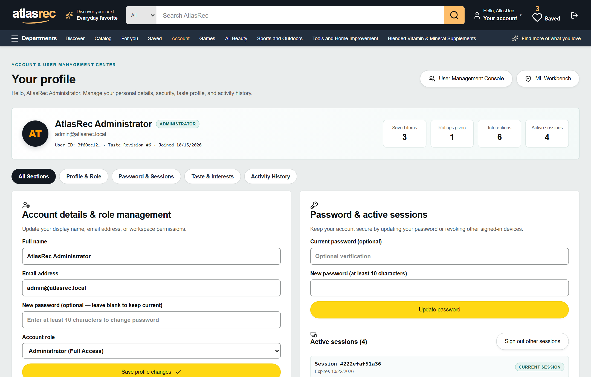

---

### 🔐 Feature 11: Argon2id Password Update & Active Session Revocation (`/profile`)
**What it does:** In the **`Password & Sessions`** tab, users can rotate their password (hashed with **Argon2id**) and inspect all active browser sessions with creation/expiry timestamps—including a one-click **`Sign out other sessions`** button to revoke other devices.

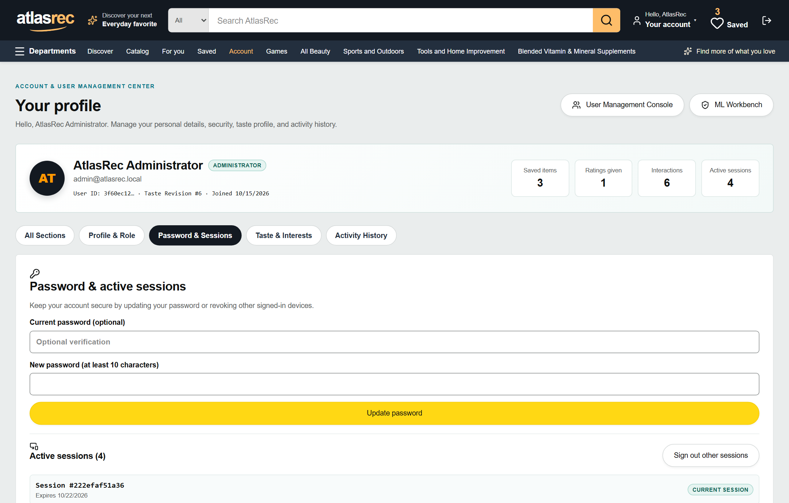

---

### 🛡️ Feature 12: Granular Activity History & Privacy Controls (`/profile`)
**What it does:** Gives users complete ownership over their AI training data. Users can filter their interaction log by **`All`**, **`Ratings`**, **`Saved`**, **`Clicks`**, **`Views`**, or **`Dismissed`**, delete individual events with the trash button (`🗑️`) to immediately remove their influence from future recommendations, clear all history, or permanently delete their account.

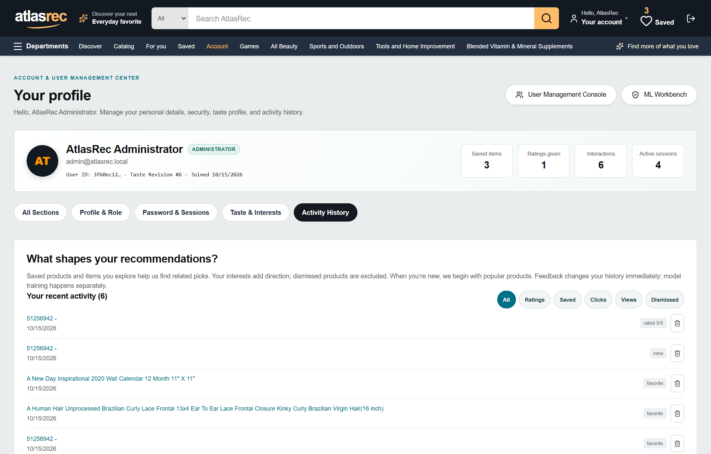

---

## 5. Feature-by-Feature Visual Tour — Admin User Management & MLOps Workbench

### 🎛️ Feature 13: Admin ML Engineering Workbench Overview (`/admin`)
**What it does:** Gives administrators and ML engineers a real-time command center displaying total catalog scale (**`20,500` products**), registered users, experiment runs, background jobs, database/model readiness, and the currently serving model bundle version (`item_cf-58ef700cbbdd`).

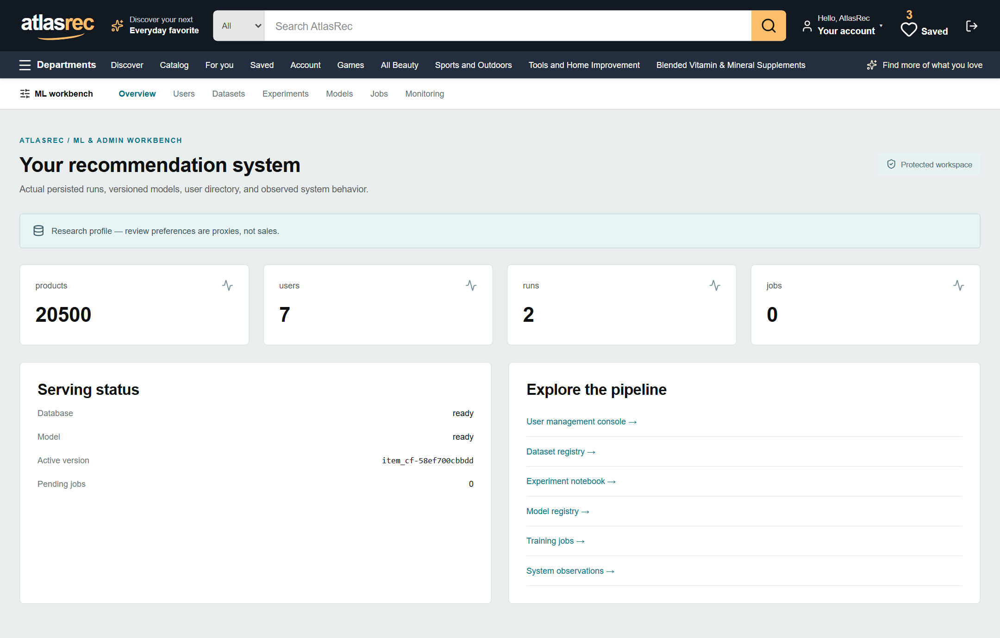

---

### 👥 Feature 14: Admin User Management Console & Live Account Editor (`/admin/users`)
**What it does:** Enables administrators to manage the entire user base from a dedicated console:
- **Live User Editor:** Click **`Edit`** on any user to update their **Full Name, Email Address, Password, Interest Categories (up to 10), or Administrator Access** in place.
- **Account Provisioning:** Create new shopper or administrator accounts directly from the workbench.
- **Directory Search & Role Filtering:** Search users by name/email, filter by `All Roles` / `Administrators` / `Standard Shoppers`, toggle roles in one click, clear a user's activity history, or delete accounts safely.

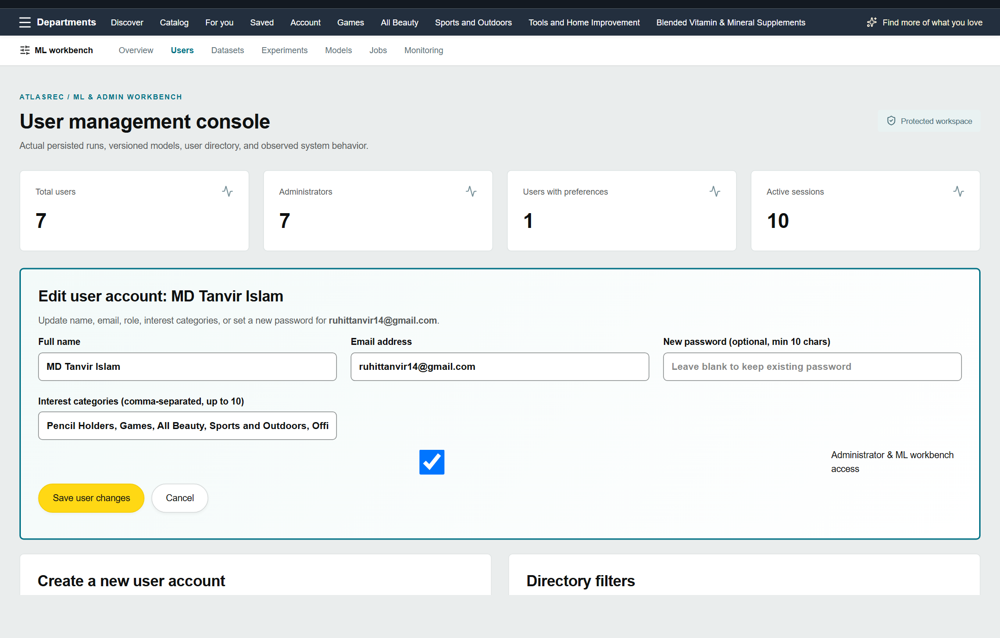

---

### 📊 Feature 15: Offline Evaluation Experiment Notebook (`/admin/experiments`)
**What it does:** Tracks reproducible offline evaluation runs across deterministic temporal splits, visualizing **`Recall@10`**, **`NDCG@10`**, and **`MRR@10`** in an interactive comparison chart with one-click CSV export (`Export results`).

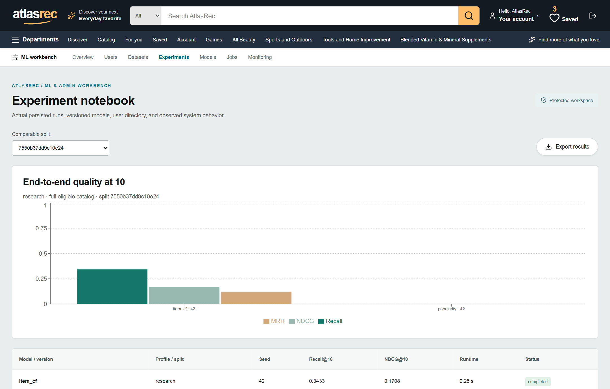

---

### 🚀 Feature 16: Versioned Model Registry & Atomic Rollback (`/admin/models`)
**What it does:** Lists all validated model bundles with checksum/dimension verification status. Engineers can **atomically promote** a candidate model to production or **roll back** to the previous serving bundle in a single click—without restarting the API server.

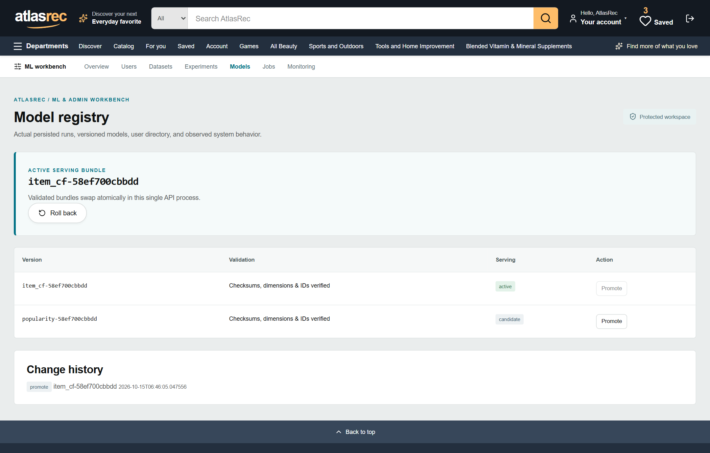

---

### 📈 Feature 17: Live Latency Telemetry & Data Drift Diagnostics (`/admin/monitoring`)
**What it does:** Monitors live serving health (`P50` / `P95` latency, cache hit rate, fallback rate) and computes **Category Total Variation Drift** and **Standardized Position Shift** between training reference distributions and live user traffic.

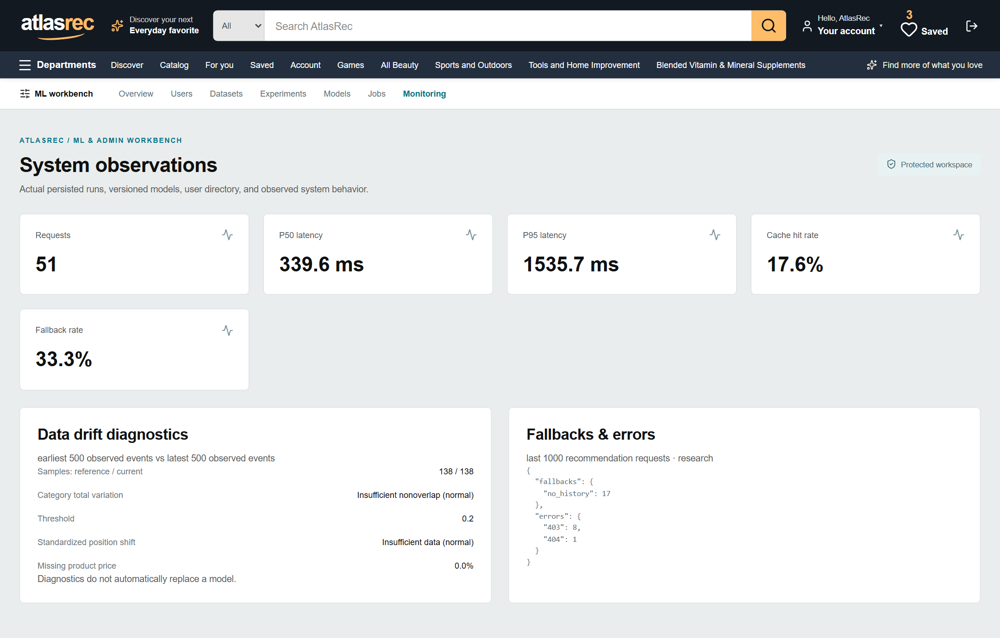

---

## 6. Machine Learning & Mathematical Architecture

### 🧠 Six Implemented Recommendation Families (`packages/ml/atlasrec_ml/models.py`)

1. **`PopularityRecommender`** — Time-aware weighted interaction popularity baseline with cold-start coverage.
2. **`ItemCFRecommender` (Item-to-Item Collaborative Filtering)** — Cosine similarity over normalized sparse user–item interaction matrices with configurable $k$-nearest neighbor pruning.
3. **`UserCFRecommender` (User-to-User Collaborative Filtering)** — Peer neighborhood aggregation weighted by user similarity.
4. **`MatrixFactorizationRecommender` (`TruncatedSVD`)** — Latent factor decomposition projecting users and items into a shared low-dimensional embedding space (`FAISS` inner-product indexed).
5. **`ImplicitALSRecommender` (Alternating Least Squares)** — Confidence-weighted implicit feedback factorization following Hu, Koren & Volinsky.
6. **`HybridRecommender` (Two-Stage Retrieval + Linear/GBDT Ranker)** — Combines collaborative candidate retrieval with content/category affinity features.

### 📐 Real-Time Counterfactual & MMR Scoring Formula

When a user interacts with the **Taste Studio**, the serving engine (`services/api/atlasrec_api/routers/recommendations.py`) computes the active user profile from non-muted seeds $S_{\text{active}} = S_{\text{user}} \setminus S_{\text{muted}}$ and scores each candidate item $i$ according to the active intent mode $m \in \{\text{balanced}, \text{hidden\_gems}, \text{budget}, \text{premium}\}$:

$$\text{Score}_m(u, i) = w_{\text{taste}}^{(m)} \cdot \text{Sim}(S_{\text{active}}, i) + w_{\text{interest}}^{(m)} \cdot \mathbb{I}(c_i \in C_u) + w_{\text{novelty}}^{(m)} \cdot \text{Novelty}(i) + w_{\text{pop}}^{(m)} \cdot \text{Pop}(i) + w_{\text{price}}^{(m)} \cdot \text{PriceFit}(i)$$

To prevent monotonous shelves, **Maximal Marginal Relevance (MMR)** iteratively selects the next item $i^*$ that maximizes relevance while penalizing category redundancy against already-selected items $R$:

$$i^* = \arg\max_{i \in Candidates \setminus R} \left[ (1 - \lambda_{\text{div}}) \cdot \text{Score}_m(u, i) - \lambda_{\text{div}} \cdot \max_{j \in R} \mathbb{I}(c_i = c_j) \right]$$

---

## 7. Full-Stack Engineering & Security Highlights

- **🔐 Production-Grade Authentication & Security:**
  - **Argon2id** password hashing (`argon2-cffi`) with automatic salt generation.
  - **HTTP-Only Signed Session Cookies** paired with **Double-Submit CSRF Protection** (`X-CSRF-Token`) on all state-mutating endpoints.
  - **Role-Based Access Control (RBAC)** separating shopper routes from protected `/api/v1/admin/*` endpoints, with server-side guards preventing accidental lockout of the last administrator.
- **⚡ High-Concurrency & Low-Latency Serving:**
  - Immutable, checksum-verified model bundles loaded in memory with thread-safe atomic swapping (`RLock`).
  - User `history_revision` cache keys ensure recommendations invalidate and refresh the exact millisecond a user saves, rates, or deletes an item.
- **🛡️ Zero Data Leakage Evaluation:**
  - Chronological per-user temporal splits (`train` $\rightarrow$ `val` $\rightarrow$ `test`) ensure future interactions never leak into past feature computation.

---

## 8. Quick Start & Local Commands

### Option A: One-Command Launcher (Docker or Local Stack)

```powershell
# 1. Check environment readiness
python scripts/manage.py doctor

# 2. Start the full application stack
python scripts/manage.py start
```

- **Storefront UI:** [http://localhost:3000](http://localhost:3000)
- **Interactive Taste Studio:** [http://localhost:3000/for-you](http://localhost:3000/for-you)
- **User Profile & Security Center:** [http://localhost:3000/profile](http://localhost:3000/profile)
- **Admin ML & User Workbench:** [http://localhost:3000/admin](http://localhost:3000/admin)
- **FastAPI OpenAPI Docs:** [http://localhost:3000/api/v1/openapi.json](http://localhost:3000/api/v1/openapi.json)

> **Demo Admin Credentials:**
> - **Email:** `admin@atlasrec.local`
> - **Password:** `AtlasDemo!2026`

### Option B: Native Development & Automated Verification

```powershell
# Install Python & Node dependencies
uv sync --python 3.12 --frozen
npm ci

# Run the full Python unit/integration test suite + Playwright E2E browser checks
python scripts/manage.py verify

# Re-capture all 17 README screenshots from the live running app
node scripts/capture_readme_tour.js
```

---

## 9. Repository Structure

```text
AtlasRec/
├── apps/web/                        # Next.js 15 (React 19) Storefront & Admin Workbench
│   ├── app/                         # App Router pages (/catalog, /for-you, /profile, /admin/*)
│   ├── components/
│   │   ├── shop/                    # Modular storefront components
│   │   │   ├── discover.jsx         # Homepage hero, department grid & personalized rails
│   │   │   ├── catalog.jsx          # 20,500+ product search & multi-facet filter explorer
│   │   │   ├── collections.jsx      # Taste Studio, What-If Sandbox, Match DNA, Compare & Bundles
│   │   │   ├── product-detail.jsx   # Product page, zoom gallery, 5-star ratings & pairings
│   │   │   └── account.jsx          # Auth, User Profile Hub, Security Sessions & Activity Privacy
│   │   ├── admin.jsx                # Admin ML Workbench & User Management Console
│   │   └── ui.jsx                   # Shared retail header, cards, notifications & primitives
│   └── lib/                         # API client, CSRF handling & image resolvers
├── services/api/                    # FastAPI Backend Service
│   ├── alembic/                     # Database schema migrations
│   └── atlasrec_api/
│       ├── routers/                 # Modular REST routers (catalog, recommendations, account, admin)
│       ├── models.py                # SQLAlchemy 2.0 ORM models (User, Session, Product, Event, Run)
│       ├── lifecycle.py             # Thread-safe model bundle loader & atomic swap/rollback
│       └── security.py              # Argon2id password hashing & CSRF token generation
├── packages/ml/                     # Shared Python ML Package (atlasrec_ml)
│   └── atlasrec_ml/
│       ├── models.py                # 6 recommendation algorithms (Popularity, CF, SVD, ALS, Hybrid)
│       ├── pipeline.py              # Temporal splitting, training & bundle serialization
│       ├── metrics.py               # Recall@K, NDCG@K, MRR@K, Coverage & Novelty metrics
│       └── serving.py               # Fast in-process candidate scoring & FAISS retrieval
├── scripts/                         # Catalog generators, benchmarks & Playwright screenshot automation
├── tests/                           # Pytest API/ML suites & Playwright desktop/mobile E2E specs
└── docs/                            # Architecture docs, model cards, evaluation reports & screenshots
```

---

<div align="center">
  <b>Designed & Engineered by <a href="https://github.com/Tanvir284">Md Tanvir Islam</a></b><br/>
  <sub>Star ⭐ this repository if you found the architecture, explainable AI UX, or MLOps workbench inspiring!</sub>
</div>
