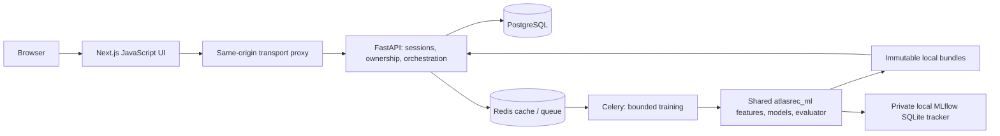

# Built architecture

Python owns business rules, authorization, writes and training. The Next route handler
forwards cookies, Origin and CSRF headers; it has no duplicate business implementation.
API_INTERNAL_URL is server-only and read at runtime. Browser calls use /api/v1 without
tokens in localStorage. Compose exposes only localhost:3000; databases/tracker are private.

## API layout (`services/api/atlasrec_api`)

| Module | Responsibility |
|---|---|
| `main.py` | Composition root: app, request middleware, router mounting |
| `routers/health.py` | `/health/live`, `/health/ready` |
| `routers/auth.py` | CSRF bootstrap, register, login, logout |
| `routers/account.py` | `/me`, preferences, history, favorites |
| `routers/catalog.py` | Categories, search/filter, product detail |
| `routers/events.py` | Idempotent feedback events |
| `routers/recommendations.py` | Recommendation hot path and history signals |
| `routers/admin.py` | Datasets, experiments, registry, jobs, monitoring |
| `common.py`, `schemas.py` | Shared helpers and request models |
| `cache.py`, `ratelimit.py` | Shared Redis client; sliding-window auth limit |
| `lifecycle.py` | Model loading, promotion, registration |

Auth rate limiting lives in Redis, so the limit is shared by every API process and
survives restarts; if Redis is unreachable it falls back to a per-process window.

The storefront UI is split the same way under `apps/web/components/shop/`
(discover, catalog, collections, product-detail, account) and formatted with Prettier.

Each recommendation takes one loaded model object and version, constructs history from
owned app events, applies preferences, filters unavailable/seen/dismissed products,
reranks diversity and supplements missing slots with valid category/popularity picks.
A persisted request links visible impressions to actually served items. Query cache
and Redis recommendation cache are distinct; cache keys include model/history revision.

The hot path reads the catalog as `(id, category)` pairs and loads full product rows
only for the returned items; history is read as narrow tuples; back-fill uses a bounded
heap. Composite indexes (migration 0004) cover a user's chronological events, the
available catalog and recent recommendation requests.

Offline data/parser/features/models/evaluation are shared by CLI and Celery. Jobs persist
status and never activate their candidate automatically. Bundles validate dependencies,
checksums, IDs and index vectors before explicit promotion. Every request reads the
active version id from PostgreSQL without taking a lock; the loader lock is held only
while a new bundle is read from disk. A promotion made by any process is therefore
picked up by every process on its next request, so `API_WORKERS` may exceed one
(each process holds its own model copy in memory; default remains one for 8GB hosts).

The isolated browser fixture uses SQLite only under ATLASREC_ENV=test. This permits
independent UI verification while the host's WSL/Docker startup is blocked. It is not
the required PostgreSQL demo installation or evidence that containers work.
